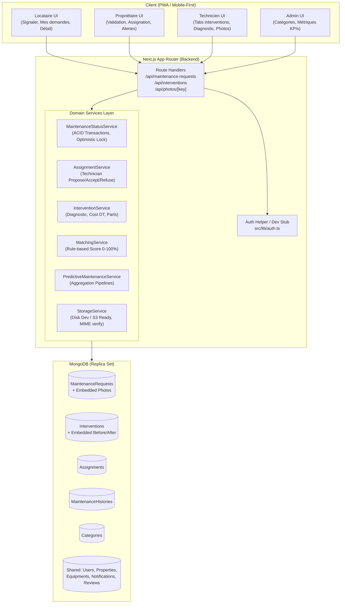

# HomeCheck Maintenance Module — Architecture Système

> **Platform**: HomeCheck (Rental Lifecycle PWA)  
> **Module**: Maintenance Module  
> **Tech Stack**: Next.js (App Router) + TypeScript (Strict) + Tailwind CSS + MongoDB (Mongoose) + Zod + Vitest  

---

## 1. Diagramme d'Architecture Globale

Le module de maintenance est strictement découplé des autres composants de l'application via des interfaces et modèles stubs bien définis :
- **Authentification** : `auth()` dans `src/lib/auth.ts` retournant `{ user: { id, role } }` avec bascule immédiate de rôle par cookie ou en-tête.
- **Propriétés & Équipements** : Modèles partagés dans `src/models/shared.ts`.
- **Inspections & IA** : Pré-remplissage automatique des signalements via query params (`sourceInspectionItemId`).
- **Notifications** : Écriture de documents `Notification` distribués aux parties prenantes.
- **Jumeau Numérique** : Journal immuable `MaintenanceHistory` traçant chaque transition d'état.
- **Stockage Privé** : `StorageService` gérant les identifiants opaques `storageKey` avec streaming authentifié.

---

## 2. Découpage Modulaire & Responsabilités

| Couche | Composants | Description |
|---|---|---|
| **Route Handlers** | `app/api/...` | Validation Zod, injection du contexte utilisateur, codes HTTP REST stricts. |
| **State Machine** | `src/modules/maintenance/state-machine.ts` | Règles pures de transition, vérification des acteurs autorisés et des gardes. |
| **Status Service** | `src/services/maintenance-status.service.ts` | Concurrence optimiste (`__v`), transactions ACID, création automatique d'historique et dispatch de notifications. |
| **Matching IA** | `src/services/matching.service.ts` | Algorithme pondéré de recommandation de techniciens avec calcul de distance Haversine. |
| **Prédictif** | `src/services/predictive.service.ts` | Pipelines d'agrégation MongoDB détectant les pannes récurrentes (≥ 2 ou 3 sur 6 mois). |
| **Stockage** | `src/services/storage.service.ts` | Téléversement sécurisé, vérification MIME et streaming privé RBAC. |
