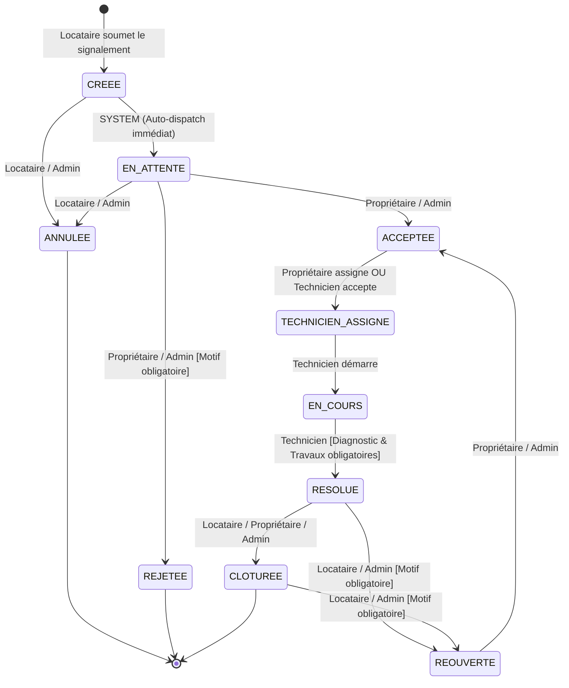

# HomeCheck Maintenance Module — Machine à États & Matrice de Transition

> **Module** : Machine à états finis avec verrous optimistes et contrôles stricts par rôle.

---

## 1. Diagramme d'États

---

## 2. Matrice des Rôles & Conditions de Garde

| Statut Actuel | Statut Cible | Acteur Autorisé | Conditions de Garde & Règles Métier |
|---|---|---|---|
| `CREEE` | `EN_ATTENTE` | `SYSTEM` | Transition immédiate déclenchée à la création par le système. |
| `CREEE` / `EN_ATTENTE` | `ANNULEE` | `TENANT`, `ADMIN` | Annulation libre par le locataire avant revue bailleur. |
| `EN_ATTENTE` | `ACCEPTEE` | `OWNER`, `ADMIN` | Approbation formelle du propriétaire. |
| `EN_ATTENTE` | `REJETEE` | `OWNER`, `ADMIN` | **Motif de rejet obligatoire** (`reason` non vide). |
| `ACCEPTEE` | `TECHNICIEN_ASSIGNE` | `OWNER`, `TECHNICIAN`, `ADMIN` | Assignation directe par le propriétaire ou acceptation par le technicien. |
| `TECHNICIEN_ASSIGNE` | `EN_COURS` | `TECHNICIAN` | Technicien démarre les travaux sur site. |
| `EN_COURS` | `RESOLUE` | `TECHNICIAN` | **Requiert obligatoirement un `diagnostic` ET `workDone` renseignés.** |
| `RESOLUE` | `CLOTUREE` | `TENANT`, `OWNER`, `ADMIN` | Confirmation de satisfaction et clôture définitive. |
| `RESOLUE` / `CLOTUREE` | `REOUVERTE` | `TENANT`, `ADMIN` | **Motif explicatif obligatoire** (`reason` non vide). |
| `REOUVERTE` | `ACCEPTEE` | `OWNER`, `ADMIN` | Prise en compte de la réouverture par le propriétaire. |
